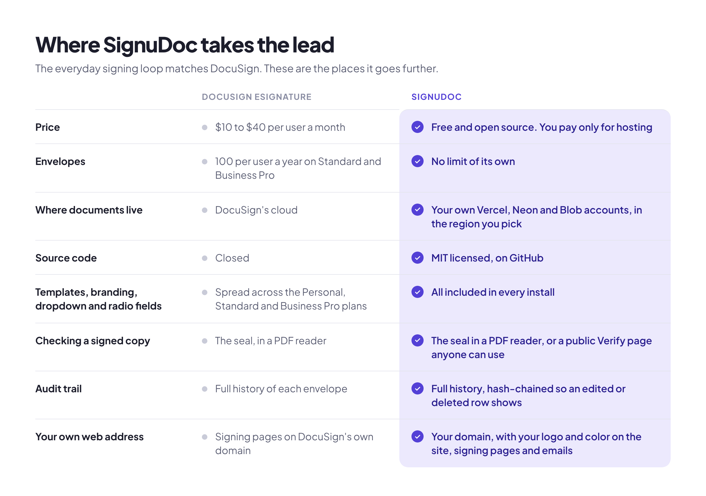
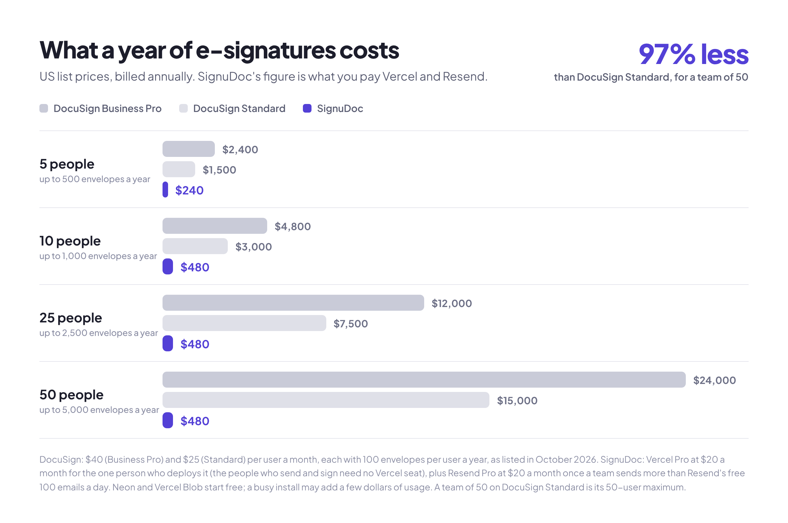

<p align="center">
  
</p>

<p align="center">
  An e-signature app for your own organization, on your own Vercel account.<br>
  Upload a PDF, place fields, send signing links, and keep the sealed, signed copy with its audit certificate.
</p>

<p align="center">
  <a href="https://vercel.com/new/clone?repository-url=https%3A%2F%2Fgithub.com%2FNYLLON-SOFTWARE%2FSignuDoc&project-name=signudoc&repository-name=signudoc&stores=%5B%7B%22type%22%3A%22integration%22%2C%22integrationSlug%22%3A%22neon%22%2C%22productSlug%22%3A%22neon%22%2C%22protocol%22%3A%22storage%22%7D%2C%7B%22type%22%3A%22blob%22%2C%22access%22%3A%22private%22%7D%2C%7B%22type%22%3A%22integration%22%2C%22integrationSlug%22%3A%22resend%22%2C%22productSlug%22%3A%22resend-email%22%2C%22protocol%22%3A%22messaging%22%7D%5D&demo-title=SignuDoc&demo-description=Your%20own%20e-signature%20site.%20Upload%20a%20PDF%2C%20place%20fields%2C%20send%20signing%20links%2C%20and%20keep%20the%20signed%20copy%20with%20its%20audit%20certificate.&demo-url=https%3A%2F%2Fgithub.com%2FNYLLON-SOFTWARE%2FSignuDoc&demo-image=https%3A%2F%2Fraw.githubusercontent.com%2FNYLLON-SOFTWARE%2FSignuDoc%2Fmain%2Fdocs%2Fimages%2Fbanner.png"></a>
</p>

<p align="center">
  <a href="#everything-it-takes-to-get-a-document-signed">Features</a> ·
  <a href="#signudoc-and-docusign-side-by-side">SignuDoc vs DocuSign</a> ·
  <a href="#what-it-costs">What it costs</a> ·
  <a href="#get-started">Get started</a> ·
  <a href="docs/self-hosting.md">Self-hosting guide</a>
</p>

## Why SignuDoc

**Pay for hosting, not for every person who sends.** SignuDoc is free and open source and runs on your own Vercel account. A team of 50 pays about $480 a year for Vercel Pro and Resend. On DocuSign Standard the same team pays $15,000, and on Business Pro $24,000.

**No envelope allowance to watch.** DocuSign's Standard and Business Pro plans include 100 envelopes per user per year. SignuDoc has no limit of its own: you send as many documents as your email plan carries.

**Your documents stay in your accounts.** PDFs live in a private Vercel Blob store and everything else in a Neon Postgres database, both in your name and in the region you choose. Nobody else hosts your agreements, and the code is yours to read, change and run.

**Evidence anyone can check.** Every finished PDF and its audit certificate carry a PAdES seal that PDF readers check for changes, the audit trail is hash-chained so an edited or deleted row shows, and anyone holding a copy can check it on the install's public Verify page.

**One click, nothing to look after.** The Deploy button creates the database, the file store and email for you, on free plans. There are no servers to patch, and every push to your copy deploys again.

## Everything it takes to get a document signed

### Prepare a document in minutes

Upload a PDF, add up to 10 signers in the order they sign, and add people who only receive the finished copy. Then place fields where they belong: signature, initials, date, text, number, checkbox, dropdown and radio buttons, each required or optional and each tied to one signer.


<p align="center">
  <sub>The organization, people and documents in these screenshots are made up.</sub>
</p>

### Signing without an account

Each signer gets a link by email, agrees to use electronic records, and signs with a typed or drawn signature on any phone, tablet or computer. Fields from earlier signers stay visible and locked. Signers can download the document before they sign, or decline with a reason, and the sender is told.


### Know who is signing

For documents that need more than an email link, ask a signer for an access code you give them yourself, or have SignuDoc email a one-time code when they open the link. The audit certificate records how each signer was checked, with their IP address and browser.

### Follow every envelope

The dashboard shows each document as a card with its first page, its status (draft, sent, completed, declined, voided or expired) and who it waits on, with search and a status filter. Each envelope has its own signing deadline, from 3 to 90 days, which you can change while it is out, and automatic reminders every 1, 2, 3 or 7 days, on top of the reminder you can send by hand.


### Templates for the documents you send every week

Open any envelope and choose Save as template. The template keeps the document, the fields and the signing order, with roles instead of names. Using it asks who signs this time and opens a draft ready to send.

### Sealed, certified, and checkable by anyone

When the last signer finishes, SignuDoc builds the signed PDF and an audit certificate, seals both, and emails them to every signer and copy recipient. Names and text in Latin, Greek, Cyrillic, Chinese, Japanese and Korean scripts are drawn correctly. Anyone can drop a copy on the Verify page to see whether it is exactly the file the site produced; the file never leaves their device, only its fingerprint does.


### Your name, logo and color

Signers see your organization, not SignuDoc. Give the install your name, logo and brand color, and they appear on the site, the signing pages and every email. Serve it at your own domain and link your own terms and privacy policy.


### Run by your administrators

The first account is the administrator, and you can make more. Choose who may create an account: people at your email domains, nobody, or anyone. People who only sign never need one. Set how long finished documents are kept, and answer a signer who asks for their data with a built-in export or erasure tool.

### On your phone

SignuDoc works on small screens as well as large ones: check on your documents from your phone, and signers sign from theirs.

<p align="center">
  
</p>

## SignuDoc and DocuSign, side by side

DocuSign does more, and charges for it per user. SignuDoc does the everyday signing loop well, and it's yours. DocuSign's plans are as [DocuSign listed them](https://ecom.docusign.com/plans-and-pricing/esignature) in October 2026, for the US.

<p align="center">
  
</p>

### Price and ownership

|                                  | SignuDoc                                                                                  | DocuSign eSignature                                                                    |
| -------------------------------- | ----------------------------------------------------------------------------------------- | -------------------------------------------------------------------------------------- |
| **Price**                        | Free and open source. You pay Vercel, and Resend once you send more than 100 emails a day | $10 (Personal), $25 (Standard) or $40 (Business Pro) per user a month, billed annually |
| **Envelopes**                    | No limit of its own                                                                       | 5 a month on Personal, 100 per user a year on Standard and Business Pro                |
| **Where it runs**                | Your Vercel account, with your Neon database and Blob store                               | DocuSign's cloud                                                                       |
| **Where data is kept**           | The region you choose, the EU included                                                    | DocuSign's data centers, the EU included                                               |
| **Source code**                  | MIT license, on GitHub                                                                    | Closed                                                                                 |
| **Your own domain and branding** | ✅ your domain, logo and color, on every plan                                             | Logo and colors from Standard                                                          |

### The signing loop

|                                              | SignuDoc                                                                                         | DocuSign eSignature                                                          |
| -------------------------------------------- | ------------------------------------------------------------------------------------------------ | ---------------------------------------------------------------------------- |
| **Signing without an account**               | ✅                                                                                               | ✅                                                                           |
| **Signing order**                            | ✅ in order, up to 10 signers                                                                    | ✅ in order, at the same time, or mixed                                      |
| **People who only get a copy**               | ✅                                                                                               | ✅ and more roles: approvers, editors, in-person signers                     |
| **Field types**                              | ✅ signature, initials, date, text, number, checkbox, dropdown, radio, each required or optional | ✅ 20+, with formulas and attachments on Business Pro                        |
| **Templates**                                | ✅                                                                                               | ✅ from Personal, shared from Standard                                       |
| **Deadlines and automatic reminders**        | ✅                                                                                               | ✅                                                                           |
| **Access code and emailed one-time code**    | ✅                                                                                               | ✅ plus SMS, phone, knowledge-based questions and ID checks, as paid add-ons |
| **Consent to electronic records**            | ✅ versioned, recorded in the audit trail                                                        | ✅                                                                           |
| **Sealed PDF and certificate of completion** | ✅ PAdES seal, self-signed by default or your own trusted certificate                            | ✅ seal trusted by PDF readers                                               |
| **Audit trail**                              | ✅ hash-chained                                                                                  | ✅                                                                           |
| **Public check of a signed copy**            | ✅ the Verify page                                                                               | —                                                                            |
| **Retention rules and signer data requests** | ✅ built in                                                                                      | ✅                                                                           |
| **Phones**                                   | ✅ in the browser                                                                                | ✅ native iPhone and Android apps                                            |

### Where DocuSign does more

|                                                         | SignuDoc                       | DocuSign eSignature                                   |
| ------------------------------------------------------- | ------------------------------ | ----------------------------------------------------- |
| **More than one document per envelope, and Word files** | — PDF only, one per envelope   | ✅                                                    |
| **Signing at the same time**                            | — in order only                | ✅                                                    |
| **Bulk send, web forms, payments**                      | —                              | ✅ on Business Pro                                    |
| **API and webhooks**                                    | — not yet                      | ✅ API plans from $50 a month                         |
| **Integrations**                                        | —                              | ✅ 1,000+, including Salesforce, Microsoft and Google |
| **Languages**                                           | — signing pages in English     | ✅ signing in 44 languages                            |
| **Single sign-on**                                      | — email and password           | ✅ SAML SSO on Enhanced                               |
| **Advanced and qualified signatures (eIDAS)**           | — simple electronic signatures | ✅                                                    |
| **HIPAA, 21 CFR Part 11, certifications**               | —                              | ✅ on Enhanced or as add-ons                          |
| **Support**                                             | GitHub issues                  | ✅ 24/7 on Enhanced                                   |

If your agreements run through Salesforce, need SMS checks or qualified signatures, or go out by the thousand in bulk, DocuSign earns its price. If you want to send everyday agreements, keep the evidence, and own the whole thing, SignuDoc is built for you.

## What it costs

SignuDoc is free. Vercel and its Marketplace partners run it, at their own prices:

|                                      | What you pay                                                                                                                                                                                                                                                                                       |
| ------------------------------------ | -------------------------------------------------------------------------------------------------------------------------------------------------------------------------------------------------------------------------------------------------------------------------------------------------- |
| **Vercel**                           | $0 on Hobby, which Vercel [limits to personal, non-commercial use](https://vercel.com/docs/limits/fair-use-guidelines). An organization belongs on [Pro](https://vercel.com/docs/plans/pro-plan), $20 a month for the one person who deploys it. The people who send and sign need no Vercel seat. |
| **Database**                         | $0 on [Neon's free plan](https://neon.com/faqs/free-plan-limits-and-quotas): 1 GB and 100 compute hours a month. Past that, Neon's Launch plan charges for use, with no monthly minimum.                                                                                                           |
| **Files**                            | 1 GB of [Vercel Blob](https://vercel.com/docs/vercel-blob/usage-and-pricing) free on Hobby. On Pro, Blob is paid from the plan's $20 monthly credit, at $0.023 per GB a month.                                                                                                                     |
| **Email**                            | $0 on [Resend's free plan](https://resend.com/pricing), up to 100 emails a day and 3,000 a month. Resend Pro is $20 a month for 50,000. Every invitation, code, reminder and finished copy is an email.                                                                                            |
| **Your own domain, if you want one** | Whatever your registrar charges. Vercel Pro includes one free for the first year.                                                                                                                                                                                                                  |

<p align="center">
  
</p>

| A year, billed annually | DocuSign Standard | DocuSign Business Pro | SignuDoc                                                     |
| ----------------------- | ----------------- | --------------------- | ------------------------------------------------------------ |
| **5 people**            | $1,500            | $2,400                | $240                                                         |
| **10 people**           | $3,000            | $4,800                | $480                                                         |
| **25 people**           | $7,500            | $12,000               | $480                                                         |
| **50 people**           | $15,000           | $24,000               | $480, plus any database or file use past the free allowances |

SignuDoc's figures assume Vercel Pro, plus Resend Pro for any team of 10 or more. A small team that stays under Resend's 100 emails a day pays only for Vercel. DocuSign's figures are its list prices; Standard stops at 50 users, and larger plans are quoted. Prices change, so check them before you quote these.

## Get started

### Deploy to Vercel

1. **Click Deploy with Vercel** above, and sign in to Vercel. It copies SignuDoc into your GitHub account and builds your site from that copy.
2. **Add the three things Vercel offers to create**, each on a free plan: a [Neon](https://neon.com) Postgres database, a private [Vercel Blob](https://vercel.com/docs/vercel-blob) store, and [Resend](https://resend.com) for email.
3. **Click Deploy.** The build creates the database tables by itself.
4. **Open your new site.** Name your organization, give the email address people should write to for help, and create the first account, which is the administrator.
5. **Set up the address you send from.** Under Settings, Organization, enter an address at your own domain. The site lists the DNS records to add and checks them for you.

There is nothing to type in Vercel and no terminal to open. Until step 5 is done, email reaches only the address on your Resend account, so you can try the whole product straight away by sending a document to yourself. The [self-hosting guide](docs/self-hosting.md) covers your own domain, locking down a new install, keeping it up to date, running in the EU, and every optional setting.

### Try it on your computer

With Node.js 24 and Docker:

```bash
npm install
cp .env.example .env
npm run db:start   # Postgres in Docker, with the schema applied
npm run dev        # SignuDoc at http://localhost:3000
```

Files stay on disk and emails are written to `.data/outbox` instead of being sent, so you need no outside account. [Development](docs/development.md) says more.

## Built on Vercel

- **Vercel-native from end to end.** Next.js 16 on Vercel Functions, Neon Postgres and Resend from the Vercel Marketplace, private Vercel Blob storage with direct browser uploads, a daily Vercel cron job for reminders and cleanup, and optional [Vercel BotID](https://vercel.com/docs/botid).
- **Secure by default.** Private file storage with no public URLs, a strict Content Security Policy, rate limits kept in Postgres, signing links that are hashed at rest, and a setup page that only the first visitor, or the holder of a `SETUP_TOKEN`, can use.
- **Tested.** Unit tests, database tests against a real Postgres, and a browser test that sets up a fresh install, sends a document and signs it, run on every pull request.

## Using SignuDoc for real agreements

SignuDoc is not a law firm and does not give legal advice, and nothing here is a promise that a signature made with it will be accepted for a given purpose. It gives you the features that electronic signature laws such as the US ESIGN Act and UETA and the EU's eIDAS regulation look for in a simple electronic signature: each signer's consent to electronic records, a record of who signed, when and how, optional identity checks, and a sealed copy that shows any change. Whether that is enough for a particular document depends on the document, where you and the signers are, and how you use it. Ask a lawyer when it matters.

Every install has a page at `/electronic-signatures` that says what it is for, and senders confirm it before each send. It is meant for ordinary business agreements, such as contracts, NDAs, statements of work, offer letters, purchase orders and approvals. It is **not** built for:

- documents that need an advanced or qualified electronic signature (AdES or QES) under eIDAS;
- FDA 21 CFR Part 11 records, or protected health information under HIPAA;
- documents that many laws keep out of electronic signature, such as wills, family-law matters, court orders, notices of foreclosure, eviction, utility shut-off or insurance cancellation, and in most EU countries real estate transfers and documents that need a notary.

Your install carries your organization's name, and your organization is responsible for how it is used: linking your own terms and privacy policy, keeping the support address pointed at a mailbox someone reads, choosing how long documents are kept, and answering signers' data requests. [Your responsibilities](docs/self-hosting.md#your-responsibilities) has the details.

## Learn more

- [Self-hosting guide](docs/self-hosting.md): deploying, first-run setup, what it costs, your own domain, updates, the EU, the seal, cleanup, rate limits, bot protection and every optional setting.
- [Development](docs/development.md): running SignuDoc locally, storage, the database, email, tests and the code's layout.
- [Contributing](CONTRIBUTING.md), [Security](SECURITY.md) and the [Code of Conduct](CODE_OF_CONDUCT.md).

## License and credits

SignuDoc is [MIT licensed](LICENSE). It redistributes third-party assets, including bundled fonts and PDF.js, under their own licenses: see [THIRD_PARTY_NOTICES.md](THIRD_PARTY_NOTICES.md).

The project has no email address of its own. Report a security problem privately through GitHub, as [SECURITY.md](SECURITY.md) describes. For help with one particular site that runs SignuDoc, write to the organization that runs it.

## Legal disclaimer

**SignuDoc is an independent open source project. It is not affiliated with, associated with, authorized by, endorsed by, sponsored by, or in any way officially connected with DocuSign, Inc., or any of its subsidiaries or affiliates.** SignuDoc is not a DocuSign product, is not built on DocuSign's software or services, and does not use DocuSign's code.

"DocuSign" and related names, marks and logos are trademarks or registered trademarks of DocuSign, Inc. in the United States and other countries. They are used in this repository only to identify DocuSign's products for the purpose of comparison. No claim is made to any of them, and their use does not imply any relationship with, or approval by, DocuSign, Inc. All other product and company names, including Vercel, Neon and Resend, are trademarks of their respective owners, and SignuDoc is not affiliated with or endorsed by them either.

The comparisons on this page were made in good faith from DocuSign's publicly available website and plan documentation as of October 2026, for its US eSignature plans, and from SignuDoc's own code. DocuSign's features, plans and prices change, vary by country and contract, and may differ from what is described here. Nothing on this page is a statement by DocuSign. Check [DocuSign's own website](https://www.docusign.com) for current and authoritative information before you rely on any of it, and tell us through a GitHub issue if something here is out of date or wrong so that it can be corrected.

The cost figures are estimates for illustration, not quotes. What you pay depends on your own use and on the prices of the services your install runs on.

SignuDoc is provided "as is", without warranty of any kind, as the [MIT License](LICENSE) sets out. Nothing in this repository is legal advice. Whether an electronic signature is valid or enforceable for a particular document depends on the law that applies to it; ask a qualified lawyer.
