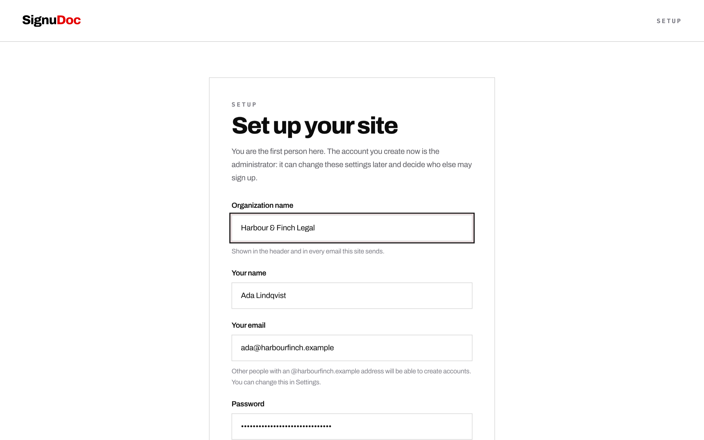

# Self-hosting SignuDoc

Everything about running your own SignuDoc: deploying it, setting it up, what it costs, keeping it up to date, and the settings you can change. For working on the code, see [Development](development.md).

- [Deploy to Vercel](#deploy-to-vercel)
- [Set the site up](#set-the-site-up)
- [Your responsibilities](#your-responsibilities)
- [Signed PDFs and the seal](#signed-pdfs-and-the-seal)
- [Running in the EU](#running-in-the-eu)
- [Daily cleanup](#daily-cleanup)
- [Rate limits](#rate-limits)
- [Bot protection](#bot-protection)
- [Hosted mode](#hosted-mode)
- [Self-hosting somewhere else](#self-hosting-somewhere-else)

## Deploy to Vercel

1. **Click "Deploy with Vercel"** in the [README](../README.md).
2. **Sign in to Vercel** and let it copy this repository into your GitHub account. Your site is built from that copy.
3. **Add the three things Vercel offers to create.** Each has a free plan:
   - a Postgres database from [Neon](https://neon.com) (pick the region closest to you),
   - a private file store, [Vercel Blob](https://vercel.com/docs/vercel-blob), for the documents,
   - [Resend](https://resend.com) for sending email.
4. **Click Deploy.** The build creates the database tables by itself.
5. **Open your new site.** It takes you to a setup page, where you name your organization, give the email address people should write to for help, and create the first account. That account is the administrator.
6. **Set up the address you send from.** Under Settings, Organization, enter an address at your own domain in "Send email from" and save (the setup page offers the same field). The site lists the DNS records for that domain and checks them for you. Add them where your domain is managed. If your Resend key is not allowed to manage domains, the page sends you to Resend's dashboard for this step instead.



Step 6 is the one part that cannot be done for you: every email provider asks for proof that you own the domain you send from. While "Send email from" is empty, email goes out from Resend's test address, which Resend delivers only to the email address of the Resend account itself, normally the one on your Vercel account. So to try the whole product straight away, leave that field empty and send a document to that address. Once you save an address of your own, email is sent from it, and Resend does not deliver it until the domain shows as verified. Add the records before you count on it.

If the site opens on a page that says to connect a database, the database was not connected when the site was built. Connect it under Storage in the Vercel project, deploy again and reload.

### What it costs

[What it costs](../README.md#what-it-costs), in the README, puts a year of SignuDoc next to DocuSign for teams of 5 to 50.

- **Vercel.** The free Hobby plan is enough to run SignuDoc, but Vercel [limits Hobby to personal, non-commercial use](https://vercel.com/docs/limits/fair-use-guidelines). An organization using this for its work belongs on Vercel Pro. Everything here works the same on both.
- **Neon, Vercel Blob and Resend** each have a free plan with limits: see [Neon](https://neon.com/faqs/free-plan-limits-and-quotas), [Vercel Blob](https://vercel.com/docs/vercel-blob/usage-and-pricing) and [Resend](https://resend.com/pricing). The one you are most likely to meet first is Resend's, which at the time of writing allows 100 emails a day and 3,000 a month on its free plan. Every signing invitation, reminder and completed copy is an email.

### Use your own web address

Add your domain to the project in Vercel (Settings, Domains), then deploy once more. The site works out its own address from the project's production domain, so the links in its emails follow the new domain after that deployment. Nothing needs to be set by hand.

### Lock down a new install

A new install is claimed by whoever opens it first. That is normally you, seconds after the deployment finishes. If its address will be known to others before you get there, add a `SETUP_TOKEN` environment variable in Vercel with a secret of your own and deploy again: the setup page then asks for it.

### Keep your install up to date

The Deploy button makes a copy of this repository, and a copy does not receive new versions by itself. To take a new version, bring the changes into your copy and push. Vercel builds the push, and the build applies any new database migrations.

```bash
git clone https://github.com/<your-account>/signudoc.git
cd signudoc
git remote add upstream https://github.com/NYLLON-SOFTWARE/SignuDoc.git
git fetch upstream
git merge upstream/main
git push
```

If git answers `refusing to merge unrelated histories`, your copy was made without this project's history. As long as you have not changed the code yourself, take the new version as it is:

```bash
git reset --hard upstream/main
git push --force-with-lease
```

After that first time, `git merge upstream/main` works as above.

### Optional settings

A deployment made with the button needs no environment variables. These are there if you want them, under Settings, Environment Variables in the Vercel project. Deploy again after changing one.

| Variable                               | What it does                                                                                                                                                |
| -------------------------------------- | ----------------------------------------------------------------------------------------------------------------------------------------------------------- |
| `SETUP_TOKEN`                          | A secret the setup page asks for. See [Lock down a new install](#lock-down-a-new-install).                                                                  |
| `CRON_SECRET`                          | Closes the daily cleanup route to everyone but Vercel's own cron call. See [Daily cleanup](#daily-cleanup).                                                 |
| `BOTID`                                | `1` turns on Vercel BotID for sign-in, sign-up and setup. See [Bot protection](#bot-protection).                                                            |
| `RESEND_FROM_EMAIL`, `SUPPORT_EMAIL`   | Fix the sender and support addresses from the environment instead of in Settings.                                                                           |
| `BETTER_AUTH_SECRET`                   | Your own secret for signing sessions. Without it one is derived from the database password, so changing that password signs everyone out.                   |
| `APP_URL`                              | The site's public address, if it should not be the project's production domain.                                                                             |
| `HOSTED_MODE`                          | `1` runs SignuDoc as a public service under its own name. See [Hosted mode](#hosted-mode).                                                                  |
| `RESEND_REGION`                        | Where Resend sends from when the app adds your domain, for example `eu-west-1`. See [Running in the EU](#running-in-the-eu).                                |
| `SEAL_P12_BASE64`, `SEAL_P12_PASSWORD` | Seal finished PDFs with a certificate from a certificate authority instead of the install's own. See [Signed PDFs and the seal](#signed-pdfs-and-the-seal). |
| `SEAL_TIMESTAMP_URL`                   | An RFC 3161 timestamp server that adds a trusted time to each seal.                                                                                         |

## Set the site up

The first time you open a new install it takes you to `/setup`. There you name your organization, give its support address, and create the first account, which becomes the administrator. After that the setup page is gone for good.

- **Support address.** Setup does not finish without one. It is the address signers and people with an account are told to write to, and where replies to the site's emails go. It is saved in your install's own settings and nowhere else; there is no SignuDoc address that it falls back to. The administrator can change it under Settings, Organization, but not remove it.

- **Who can sign up.** The install starts by letting people with an email address at the administrator's own domain create accounts (or nobody else, if the administrator used a public mailbox such as Gmail). The administrator can change this under Settings, Organization: people at listed domains, nobody, or anyone. People who are only sent a document to sign never need an account.
- **More administrators.** Settings, Organization lists everyone with an account under People, where an administrator can make someone else an administrator or take that away. There is always at least one. When an account is closed, its finished documents and their audit trails move to the longest-standing administrator, because they are the organization's records. If that person later stops being an administrator, those documents move on to one who stays, and the documents they sent themselves stay with them.
- **Email.** Settings, Organization also shows whether email is working. While no sender address is set, mail goes out from Resend's test address, which only reaches the owner of the Resend account. Enter a sender address at your domain and the page shows the DNS records to add and checks them for you. Mail from that address is not delivered until its domain is verified.
- **`SETUP_TOKEN`.** A new install can be claimed by whoever opens it first. If its URL will be public before you get to it, set `SETUP_TOKEN` to a secret of your own and the setup page will ask for it.
- **An install from before this page existed** has accounts but no administrator. Set `SETUP_TOKEN`, sign in with the account that should be in charge, and open `/setup`. It asks for a support address if the install has none. Sign-up stays open, as it was, until that administrator changes it.

## Your responsibilities

Your install carries your organization's name, not SignuDoc's. In Settings, link your own terms and privacy policy (without a privacy link, signers see a notice built from your settings at `/signer-privacy`; check it), keep the support address you gave at setup pointed at a mailbox someone reads, and choose how long finished documents are kept. Under GDPR your organization is the controller; Settings, Organization has the tools to answer a signer who asks for their data or for its erasure.

## Signed PDFs and the seal

Every finished PDF and audit certificate is sealed with a PAdES signature, so any change after signing shows in Adobe Acrobat and other PDF readers, and its SHA-256 is recorded. Anyone can check a copy at `/verify`. The audit trail in the database is a hash chain, so an edited or deleted row shows too.

By default each install makes its own seal key and self-signed certificate the first time it seals, and keeps the key encrypted in the database with a key derived from `BETTER_AUTH_SECRET` (or the database password, when that is unset). Keep that secret stable: a new one makes a new seal key, and old PDFs still verify but under the old certificate. Readers show a self-signed seal as "validity unknown" until the certificate is trusted. For a seal readers trust on sight, buy a document-signing certificate and set `SEAL_P12_BASE64` and `SEAL_P12_PASSWORD`. `SEAL_TIMESTAMP_URL` adds a trusted time from a timestamp server.

## Running in the EU

By default the parts of an install run in the US. To keep signers' data in the EU:

1. **Functions.** Add `"regions": ["fra1"]` to `vercel.json` (or pick Frankfurt under Settings, Functions in the Vercel project).
2. **Database.** Create the Neon database in an EU region (Frankfurt) when you connect it.
3. **Files.** Create the Vercel Blob store in an EU region (Frankfurt).
4. **Email.** Set `RESEND_REGION=eu-west-1` before you add your domain in Settings, or create the domain in Resend's dashboard with the Ireland region. Resend still keeps account data and email logs in the US.
5. **Agreements.** Accept the data processing agreements of Vercel, Neon and Resend, which include the EU standard contractual clauses, and list them in your privacy policy.

Some data still leaves the EU: Vercel's and Resend's account metadata and logs, for example. The processors' agreements and the EU-US Data Privacy Framework cover that, but check it against your own obligations.

## Daily cleanup

Once a day the app deletes drafts nobody has touched for 30 days, finishes account deletions that were requested, and clears expired download links and finished rate limit counters. The same run sends the automatic reminders that are due and tells a sender when an envelope has passed its signing deadline. The work is done by a request to:

```text
/api/internal/retention
```

- **On Vercel** this is already scheduled: `vercel.json` has a cron job that calls it once a day. There is nothing to set up.
- **Anywhere else**, have your own scheduler send it a `GET` or `POST` once a day.

A new install has no secret for this route, so the route looks after itself: it runs at most once an hour, never twice at the same time, and answers with an empty response either way. Someone who finds the URL can only make the day's cleanup happen earlier.

To close the route, set a secret. A caller then has to send `Authorization: Bearer <secret>`, and gets a summary of what was cleaned up in return.

- `CRON_SECRET` is the one to use on Vercel, because Vercel sends it on its own cron calls.
- `RETENTION_JOB_SECRET` does the same for a scheduler of your own. On Vercel, a deployment that sets only this one turns Vercel's cron call away, so store the secret as `CRON_SECRET` there instead.

## Rate limits

Sign-in, sign-up, password reset, the signing pages, uploads and sending are rate limited per visitor. The counts are kept in the `rate_limits` table in Postgres, so they hold across every instance of the app. On Vercel the visitor's address is read from the header Vercel sets itself, which a visitor cannot forge. If the database cannot be reached, each instance falls back to counting in its own memory.

## Bot protection

The app can use [Vercel BotID](https://vercel.com/docs/botid), an invisible check that a request comes from a real browser, on the requests a script would go for: creating an account, signing in, asking for a password reset or verification email, the contact form and first-run setup.

It is off by default. To turn it on, set `BOTID=1` on a Vercel deployment and redeploy; the setting is read when the app is built. BotID's basic check is free on every Vercel plan, and its deeper check is a paid option you switch on in the Vercel dashboard. It does nothing anywhere other than Vercel.

It is opt-in for now because it has not yet been proven against a live Vercel deployment. If you turn it on, try signing in from a private window straight away, and remove `BOTID` and redeploy if that fails. A check that cannot reach Vercel lets the request through, so an outage on that side does not lock people out; the rate limits apply either way.

## Hosted mode

`HOSTED_MODE=1` runs SignuDoc as a public service under its own name: the landing page at `/`, the built-in terms, privacy, contact and accessibility pages, and sign-up open to anyone. Leave it unset for an install that belongs to one organization.

## Self-hosting somewhere else

SignuDoc is a regular Next.js app and runs anywhere Node.js 24 and Postgres do:

```bash
npm run db:migrate
npm run build
npm run start
```

Away from Vercel, a few things Vercel does for you are yours to set:

- `DATABASE_URL`, pointing at your Postgres. Run `npm run db:migrate` on every deploy; it only applies what is new.
- `APP_URL`, the site's public HTTPS address.
- `BETTER_AUTH_SECRET`, at least 32 characters (`openssl rand -hex 32`). Without it a secret is derived from the database password, which must then be at least 12 characters long.
- `RESEND_API_KEY`, from your Resend account.
- Files are kept on the machine's disk under `.data/storage` (`STORAGE_LOCAL_DIR` changes where), so that disk must survive restarts. To use a Vercel Blob store from elsewhere, set `BLOB_READ_WRITE_TOKEN`.
- Leave `EMAIL_DRIVER` unset. The capture driver is for development only.

Self-hosted operators are responsible for:

- linking to their own terms and privacy policy under Settings, Organization;
- keeping the support address pointed at a mailbox someone reads, and verifying a sending domain for email;
- configuring retention, consent, and compliance requirements for their own deployment; and
- scheduling the [daily cleanup](#daily-cleanup) if they are not on Vercel, where it is scheduled for them.
