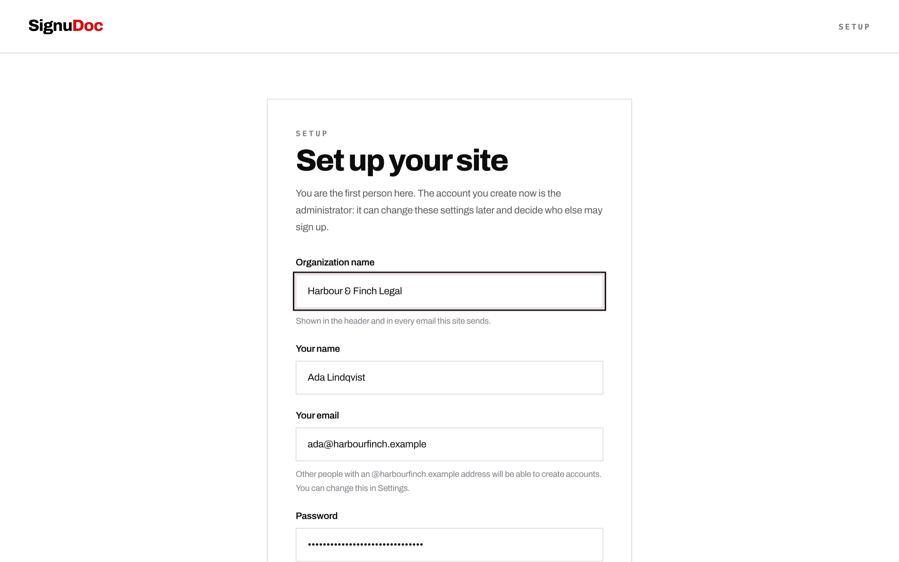

# Self-hosting SignuDoc

Everything about running your own SignuDoc: deploying it, setting it up, what it costs, keeping it up to date, and the settings you can change. For working on the code, see [Development](development.md).

- [Deploy to Vercel](#deploy-to-vercel)
- [Set the site up](#set-the-site-up)
- [Your responsibilities](#your-responsibilities)
- [Signed PDFs and the seal](#signed-pdfs-and-the-seal)
- [Running in the EU](#running-in-the-eu)
- [Daily cleanup](#daily-cleanup)
- [Rate limits](#rate-limits)
- [Bot protection](#bot-protection)
- [Hosted mode](#hosted-mode)
- [Self-hosting somewhere else](#self-hosting-somewhere-else)

## Deploy to Vercel

1. **Click "Deploy to Vercel"** in the [README](../README.md).
2. **Sign in to Vercel** and let it copy this repository into your GitHub account. Your site is built from that copy.
3. **Add the three things Vercel offers to create.** Each has a free plan:
   - [Resend](https://resend.com) for sending email (it comes first because its domain takes the longest to be ready),
   - a Postgres database from [Neon](https://neon.com) (pick the region closest to you),
   - a private file store, [Vercel Blob](https://vercel.com/docs/vercel-blob), for the documents.
4. **Click Deploy.** The build creates the database tables by itself. If it stops with "One or more integration resources failed to provision", see [If the first deployment fails](#if-the-first-deployment-fails).
5. **Open your new site.** It takes you to a setup page, where you name your organization, give the email address people should write to for help, and create the first account. That account is the administrator.
6. **Set up the address you send from.** Under Settings, Organization, enter an address at your own domain in "Send email from" and save (the setup page offers the same field). The site lists the DNS records for that domain and checks them for you. Add them where your domain is managed. If your Resend key is not allowed to manage domains, the page sends you to Resend's dashboard for this step instead.



Step 6 is the one part that cannot be done for you: every email provider asks for proof that you own the domain you send from. While "Send email from" is empty, email goes out from Resend's test address, which Resend delivers only to the email address of the Resend account itself, normally the one on your Vercel account. So to try the whole product straight away, leave that field empty and send a document to that address. Once you save an address of your own, email is sent from it, and Resend does not deliver it until the domain shows as verified. Add the records before you count on it.

### If the first deployment fails

Vercel starts the first deployment as soon as the last store is added. Resend asks for a domain, sets it up and then checks its DNS records, and that can take a few minutes. If the deployment starts before Resend is ready, Vercel stops it before the build begins, with "One or more integration resources failed to provision". Your copy of SignuDoc is fine, and the database, file store and email are all created.

1. Wait a minute or two.
2. Refresh the page. In the Vercel project, Storage lists Resend, Neon and Blob.
3. Open Deployments, open the failed deployment's menu (⋯), and click **Redeploy**.

If it fails the same way again, wait a few more minutes and redeploy once more. A deployment that fails during the build, with a log, is a different problem: the log says what went wrong.

The build itself never waits on Resend. SignuDoc builds and runs without email, and Settings, Organization says when email is not connected yet.

If the site opens on a page that says to connect a database, the database was not connected when the site was built. Connect it under Storage in the Vercel project, deploy again and reload.

### What it costs

[What it costs](../README.md#what-it-costs), in the README, puts a year of SignuDoc next to a per-seat e-signature plan for teams of 5 to 50.

- **Vercel.** The free Hobby plan is enough to run SignuDoc, but Vercel [limits Hobby to personal, non-commercial use](https://vercel.com/docs/limits/fair-use-guidelines). An organization using this for its work belongs on Vercel Pro. Everything here works the same on both.
- **Neon, Vercel Blob and Resend** each have a free plan with limits: see [Neon](https://neon.com/faqs/free-plan-limits-and-quotas), [Vercel Blob](https://vercel.com/docs/vercel-blob/usage-and-pricing) and [Resend](https://resend.com/pricing). The two you are most likely to meet first, at the time of writing, are Resend's 100 emails a day, which is about 20 two-signer documents, and Vercel Blob's 2,000 uploads a month, which is about 250 documents. Every signing invitation, reminder and completed copy is an email, and every PDF, sealed copy and certificate is an upload. [What it costs](../README.md#what-it-costs) in the README works through all of the limits. None of these plans bills you for going over. It stops instead, until the month turns over or, for the two 1 GB storage limits, until you delete old documents or move up.

### Use your own web address

Add your domain to the project in Vercel (Settings, Domains), then deploy once more. The site works out its own address from the project's production domain, so the links in its emails follow the new domain after that deployment. Nothing needs to be set by hand.

### Lock down a new install

A new install is claimed by whoever opens it first. That is normally you, seconds after the deployment finishes. If its address will be known to others before you get there, add a `SETUP_TOKEN` environment variable in Vercel with a secret of your own and deploy again: the setup page then asks for it.

### Database variables marked "Needs Attention"

After the deploy, the Neon variables in your Vercel project (`DATABASE_URL`, `PGPASSWORD`, the `POSTGRES_*` ones and the rest, all but `NEON_PROJECT_ID`) carry a yellow "Needs Attention" badge. Nothing is broken and the site works as it is. Vercel shows the badge on any value that looks like a password but is stored so that project members can still read it, and the Deploy button can only connect Neon that way, because a connection that includes the Development environment cannot store its values as Secrets.

To clear it, make the database's values write-only. This stays inside Vercel:

1. Open the project in Vercel, then **Storage**, then the Neon database, then **Settings**.
2. Under **Allowed Environments**, choose **Production only** and save. Vercel removes the Preview and Development connections and stores the values as Secrets.
3. On the same page, under **Secure This Resource**, click **Rotate Secrets**, so the database password that was readable before stops working.
4. While you are in the project, add a `BETTER_AUTH_SECRET` environment variable (Production, as a Secret) with a value from `openssl rand -hex 32`, so later password changes leave sign-ins alone.
5. Open **Deployments** and redeploy the latest production deployment.

Do this right after the deploy, before people use the site. Unless `BETTER_AUTH_SECRET` was already set, the site's own secret comes from the database password, so step 3 (and step 4) changes it: everyone is signed out, the site makes a new key for sealing documents (PDFs sealed before still verify, under the old certificate), and anyone in the middle of signing with an outside signing provider has to start that step again.

After this, preview deployments have no database and open on the page that asks you to connect one. That only matters if you build changes on branches before putting them live.

### Keep your install up to date

The Deploy button makes a copy of this repository in your GitHub account, and Vercel deploys every push to it. A copy does not receive new versions by itself: an update means bringing a new [release](https://github.com/NYLLON-SOFTWARE/SignuDoc/releases) into your copy. Vercel then builds it, and the production build applies any new database migrations.

**See whether there is one.** Sign in as the administrator and open Settings. The SignuDoc section shows the version the site runs; **Check for updates** asks GitHub for the latest release and shows what is new in it.

**Take it with the update workflow.** Your copy has a GitHub Actions workflow, `.github/workflows/update-signudoc.yml`, that does the git work for you:

1. In your repository on GitHub, open **Actions**, then **Update SignuDoc**, and press **Run workflow**. (Settings in SignuDoc links straight there.) It also runs by itself every Monday.
2. It merges the release with your copy on a branch named `signudoc-update/<version>` and opens a pull request. Vercel builds a preview of that branch.
3. Look at the preview, then merge the pull request. Vercel deploys it to your site.

Using it costs nothing: a run takes well under a minute, and private repositories get 2,000 free Actions minutes a month.

What the workflow does and does not do:

- **Your changes are kept.** It does a three-way merge between the SignuDoc version your copy is based on, your copy, and the new release, so code you changed stays changed. Where you and SignuDoc changed the same lines, it stops without touching anything and lists the files in the run's summary. Then update by hand, below.
- **It works out which SignuDoc version your copy started from** by comparing its first commit with this project's history. If the first commit was edited and two versions fit equally well, the run stops and asks you to run it again with **Based on** set to the release you deployed, such as `v0.1.0`.
- **It never force-pushes** and never changes your production branch unless you ask it to (below). Everything arrives as a pull request.
- **Database changes wait for the merge.** Preview builds do not touch the database (they share it with production unless you set `MIGRATE_ON_PREVIEW=1`), so a preview of an update that changes the database may show errors on pages that need the change. The pull request says when an update changes the database. Merging applies it during the production build. A database change stays if you later roll the site back to an older deployment, so do not roll back across an update that changed the database.
- **Files in `.github/workflows` are left alone.** GitHub does not let a workflow's own token change workflow files. When a release changes one, the pull request lists it, and you can copy it from the release by hand. To have the workflow update them too, add the token below.

Two optional settings in your repository on GitHub:

- **Let the workflow open the pull request.** In Settings, Actions, General, under Workflow permissions, tick **Allow GitHub Actions to create and approve pull requests**. Without it the workflow pushes the branch and its summary links to the page where you open the pull request with one click.
- **`SIGNUDOC_UPDATE_TOKEN`**, a repository secret (Settings, Secrets and variables, Actions). Make a [fine-grained personal access token](https://github.com/settings/personal-access-tokens/new) for your copy only, with read and write access to Contents, Pull requests and Workflows. The workflow uses it instead of its own token, so it can update workflow files and does not need the setting above. Added after an update left workflow files behind, the next run brings them in with a pull request of their own.

To skip the pull request, run the workflow with **Merge straight into the production branch** ticked, or set the repository variable `SIGNUDOC_AUTO_MERGE` to `1` to have the weekly run do that. It only does so when the release merges cleanly. Vercel then deploys the update without anyone looking at it first.

If Vercel deploys your site from a branch other than the repository's default branch, set the repository variable `SIGNUDOC_PRODUCTION_BRANCH` to that branch, so the workflow updates and opens pull requests against it.

**A copy made before version 0.2.0** does not have the workflow yet. Add it once: in your repository on GitHub choose **Add file**, **Create new file**, name it `.github/workflows/update-signudoc.yml`, paste in [the workflow](https://raw.githubusercontent.com/NYLLON-SOFTWARE/SignuDoc/main/.github/workflows/update-signudoc.yml), and commit it to your production branch. Settings in SignuDoc links to the right page. Then run it as above.

**Updating by hand.** A copy made by the Deploy button has none of this project's history, so a plain `git merge` refuses to merge "unrelated histories". Tell git which SignuDoc commit your copy started from, then merge as usual:

```bash
git clone https://github.com/<your-account>/signudoc.git
cd signudoc
git fetch https://github.com/NYLLON-SOFTWARE/SignuDoc.git main --tags
# The SignuDoc commit your copy started from. The workflow's summary
# names it when it stops, or use the release tag you deployed, e.g. v0.1.0.
git replace --graft "$(git rev-list --max-parents=0 HEAD)" v0.1.0
git merge v0.2.0
# Fix any clashes, commit, then:
git push
```

The graft only lives in your local clone. The merge itself is a normal commit that links the two histories, so later updates merge without it.

### Optional settings

A deployment made with the button needs no environment variables. These are there if you want them, under Settings, Environment Variables in the Vercel project. Deploy again after changing one.

| Variable                                            | What it does                                                                                                                                                                                           |
| --------------------------------------------------- | ------------------------------------------------------------------------------------------------------------------------------------------------------------------------------------------------------ |
| `SETUP_TOKEN`                                       | A secret the setup page asks for. See [Lock down a new install](#lock-down-a-new-install).                                                                                                             |
| `CRON_SECRET`                                       | Closes the daily cleanup route to everyone but Vercel's own cron call. See [Daily cleanup](#daily-cleanup).                                                                                            |
| `BOTID`                                             | `1` turns on Vercel BotID for sign-in, sign-up and setup. See [Bot protection](#bot-protection).                                                                                                       |
| `RESEND_FROM_EMAIL`, `SUPPORT_EMAIL`                | Fix the sender and support addresses from the environment instead of in Settings.                                                                                                                      |
| `BETTER_AUTH_SECRET`                                | Your own secret for signing sessions. Without it one is derived from the database password, so changing that password signs everyone out.                                                              |
| `APP_URL`                                           | The site's public address, if it should not be the project's production domain.                                                                                                                        |
| `HOSTED_MODE`                                       | `1` runs SignuDoc as a public service under its own name. See [Hosted mode](#hosted-mode).                                                                                                             |
| `RESEND_REGION`                                     | Where Resend sends from when the app adds your domain, for example `eu-west-1`. See [Running in the EU](#running-in-the-eu).                                                                           |
| `SEAL_P12_BASE64`, `SEAL_P12_PASSWORD`              | Seal finished PDFs with a certificate from a certificate authority instead of the install's own. See [Signed PDFs and the seal](#signed-pdfs-and-the-seal).                                            |
| `SEAL_TIMESTAMP_URL`                                | An RFC 3161 timestamp server that adds a trusted time to each seal, and long-term validation. See [Long-term validation](#long-term-validation).                                                       |
| `MAX_SIGNERS_PER_ENVELOPE`                          | The most signers one envelope can have, from 1 to 100. 25 when unset. See [Signing order](signing-order.md).                                                                                           |
| `EIDEASY_CLIENT_ID`, `EIDEASY_SECRET`               | Let senders ask for advanced or qualified signatures in the signers' own names, through eID Easy. See [Signatures in the signers' own names](#signatures-in-the-signers-own-names-eidas-ades-and-qes). |
| `CSC_API_URL`, `CSC_CLIENT_ID`, `CSC_CLIENT_SECRET` | The same through a trust service provider's remote signing service (CSC API v2). See [Signatures in the signers' own names](#signatures-in-the-signers-own-names-eidas-ades-and-qes).                  |
| `BACKUP_BLOB_READ_WRITE_TOKEN`, `BACKUP_KEEP_DAYS`  | A daily backup of the database and files to a second Blob store. See [Backup and restore](backup-and-restore.md).                                                                                      |
| `AUDIT_LOG`                                         | `off` keeps audit rows out of the function logs. See [Send the audit trail to your SIEM](#send-the-audit-trail-to-your-siem).                                                                          |
| `SSO_ISSUER`, `SSO_CLIENT_ID`, `SSO_CLIENT_SECRET`  | Sign in through your organization's identity provider (Okta, Entra ID, Google Workspace). `PASSWORD_SIGN_IN=off` then turns passwords off. See [Single sign-on](#single-sign-on).                      |
| `SLACK_BOT_TOKEN`                                   | Post to Slack with this bot token instead of one saved in Settings. `NOTIFICATION_EXPIRING_DAYS` and `NOTIFICATION_STUCK_DAYS` fix when warnings go out. See [Notifications](notifications.md).        |

## Set the site up

The first time you open a new install it takes you to `/setup`. There you name your organization, give its support address, and create the first account, which becomes the administrator. After that the setup page is gone for good.

- **Support address.** Setup does not finish without one. It is the address signers and people with an account are told to write to, and where replies to the site's emails go. It is saved in your install's own settings and nowhere else; there is no SignuDoc address that it falls back to. The administrator can change it under Settings, Organization, but not remove it.

- **Who can sign up.** The install starts by letting people with an email address at the administrator's own domain create accounts (or nobody else, if the administrator used a public mailbox such as Gmail). The administrator can change this under Settings, Organization: people at listed domains, nobody, or anyone. People who are only sent a document to sign never need an account.
- **More administrators.** Settings, Organization lists everyone with an account under People, where an administrator can make someone else an administrator or take that away. There is always at least one. When an account is closed, its finished documents and their audit trails move to the longest-standing administrator, because they are the organization's records. If that person later stops being an administrator, those documents move on to one who stays, and the documents they sent themselves stay with them.
- **What signers agree to before signing.** Before a signer can sign, they read a disclosure about using electronic records and signatures and tick a box to agree. The built-in disclosure says they may sign on paper instead, ask for a paper copy, and withdraw. Under Settings, Organization, "What signers agree to before signing", an administrator can write their own words in its place, or start from the standard text and change it. Separate paragraphs with a blank line, start a line with `## ` to make a heading, and write `{sender}` and `{contact}` where the sender's name and the address to write to go. Leave it empty to use the built-in text. A custom text is limited to 6,000 characters, and a heading needs words under it. Each signer's agreement records a version of the words they saw: the built-in text keeps its dated version, and a custom text is named by a fingerprint of the text, so the version changes whenever the text does. The words themselves, filled in as the signer read them, are kept in that signer's audit trail, so the record stays complete if the setting is changed later. Saving words of your own first shows a notice: the standard text covers what the U.S. E-SIGN Act requires before a consumer agrees to sign electronically (choosing paper, getting a paper copy, withdrawing and what that means, and the device and software needed), and removing or changing it may make signatures and records invalid. Saving needs an administrator to press "I agree", and each change to the setting is in the site audit trail with the version of the notice they agreed to. Saving the standard text unchanged, or going back to it, needs no notice. The consent step itself cannot be turned off. The hosted service always shows the built-in text. SignuDoc is not legal advice, and that includes the standard text: check any wording with your own legal counsel before you rely on it.
- **Email.** Settings, Organization also shows whether email is working. While no sender address is set, mail goes out from Resend's test address, which only reaches the owner of the Resend account. Enter a sender address at your domain and the page shows the DNS records to add and checks them for you. Mail from that address is not delivered until its domain is verified.
- **`SETUP_TOKEN`.** A new install can be claimed by whoever opens it first. If its URL will be public before you get to it, set `SETUP_TOKEN` to a secret of your own and the setup page will ask for it.
- **An install from before this page existed** has accounts but no administrator. Set `SETUP_TOKEN`, sign in with the account that should be in charge, and open `/setup`. It asks for a support address if the install has none. Sign-up stays open, as it was, until that administrator changes it.

## Sign-in security

These cover the people with an account (senders and administrators). Signers who are only sent a document open it from their emailed link and are not affected.

- **Two-step sign-in.** Anyone can turn it on under Settings, Two-step sign-in: after the password, the site asks for a 6-digit code from an authenticator app such as 1Password, Google Authenticator or Microsoft Authenticator. Setting it up gives ten single-use backup codes for when the phone is not at hand. The key and the backup codes are stored encrypted with `BETTER_AUTH_SECRET`, so keep that secret the same: a new one makes every authenticator stop working. If it has to change (it leaked, or it was derived from a database password that changed), clear everyone's two-step setup in the same step, or nobody who used it can sign in, administrators included. In the Neon console's SQL editor, run:

  ```sql
  update "user" set "twoFactorEnabled" = false;
  delete from "twoFactor";
  ```

  Then change the secret and deploy. Everyone signs in with their password alone once, and sets up two-step sign-in again (an install that requires it asks at once). The site audit trail does not show this reset, so record it with the incident.

- **Requiring it.** An administrator can require two-step sign-in of everyone under Settings, Organization, Sign-in security. They have to use it themselves first. From then on anyone who has not set it up sees only the setup page until they have, the API refuses their requests too, and nobody can turn theirs off.
- **Lost phone.** If someone loses their phone and their backup codes, an administrator can reset their two-step sign-in under People. That turns it off and signs them out everywhere at once; they sign in with their password and set it up again (at once, if it is required).
- **Sessions.** A session lasts 7 days by default. Under Settings, Organization, Sign-in security an administrator can sign people out after 15 minutes to 8 hours without use, and at the latest 8 hours to 3 days after they signed in. A change applies to sessions that are already open, from their next click. Anyone can sign out on every device at once under Settings, Signed-in devices.
- **Wrong passwords.** Ten wrong passwords for one email address within 15 minutes stop sign-in for that address until the 15 minutes are up. This happens whether or not the address has an account, so it says nothing about which ones do. Ten wrong codes at the second step lock that step for 15 minutes in the same way.
- **The site audit trail** (Settings, Organization, Sign-in security) records each sign-in and failed sign-in with the address it came from, lockouts, sign-outs, password changes and resets, two-step sign-in being turned on, off or reset, new backup codes, and changes to settings, roles, the logo, the email domain, identity confirmations and signing locks. The rows form one hash chain, so a changed or removed row shows, and the trail downloads as CSV.

### API keys

Another app can create and send envelopes through the [SignuDoc API](api.md). An administrator makes a key for it under Settings, Organization, API keys. The key is shown once and only its hash is stored. It acts as the administrator who made it, skips two-step sign-in (it is for servers, not people), and stops working when it is revoked, expires, or its administrator stops being one. Making and revoking keys is in the site audit trail.

### Webhooks

An administrator can add webhook endpoints under Settings, Organization, Webhooks, so another app hears when an envelope is sent, viewed, signed, completed, declined, voided or expires. Deliveries are signed, retried for about two and a half days, and listed in a delivery log. Adding, changing and removing endpoints is in the site audit trail. Retries that are due are sent by the next request that changes an envelope, the next API call, or a daily cron job on `/api/internal/webhooks`, which takes the same `CRON_SECRET` as the daily cleanup. See [Webhooks](api.md#webhooks).

### Embedded signing

An app can show the signing page inside its own site, for envelopes it sends through the API with embedded delivery: no invitations are emailed, and the app says who the signer is. An administrator lists the sites allowed to do this under Settings, Organization, Embedded signing; with none listed it is off, and no page can be framed. Removing a site stops the links already made for it. See [Embedded signing](api.md#embedded-signing).

### Send the audit trail to your SIEM

Every row added to the site audit trail or to a document's audit trail is also written to the function logs, once it is saved, as one line of JSON. So are refused requests and failures worth a look. A Vercel log drain (team Settings, Drains, or an observability integration from the Vercel Marketplace such as Datadog, Axiom or Better Stack) then delivers them to your SIEM as fields it can search and alert on. Log drains are a paid Vercel feature; see Vercel's pricing page for which plans have them.

Each line has `"source": "signudoc"` and a `type`:

- `"audit"`: a copy of an audit row. `trail` is `site` or `envelope`, and the line carries `event`, `actorEmail`, `actorUserId`, `ipAddress`, `userAgent`, `metadata`, `envelopeId` (for a document), `occurredAt`, and the row's `sequence` and `rowHash`. The database stays the record: the hash matches a line to its row, and a gap in `sequence` shows a line that did not arrive. A change that fails and is rolled back writes no line.
- `"security"`: a `category` and `message`, with the request's path (signing and download links are redacted), IP address and user, where known.

`AUDIT_LOG=off` stops the audit lines, if you would rather not have email and IP addresses in your function logs. The trails in the database are the same either way.

### Single sign-on

People can sign in through your organization's identity provider instead of with a password, over OpenID Connect. That puts your provider's own rules in charge: its MFA, its conditional access, and removing someone there removes them here at their next sign-in. It works with any provider that publishes `/.well-known/openid-configuration`, which includes Okta, Microsoft Entra ID, Google Workspace, OneLogin, JumpCloud, Keycloak and Auth0. It is optional and set up by hand, because the provider is outside Vercel.

1. In your provider, make a web application (OIDC, authorization code flow). Give it the redirect URI `https://<your site>/api/auth/callback/sso` and the scopes `openid email profile`.
2. In the Vercel project, under Settings, Environment Variables, set:
   - `SSO_ISSUER`: the provider's issuer URL. For Okta, `https://<your org>.okta.com` (or your custom authorization server's URL). For Entra ID, `https://login.microsoftonline.com/<tenant id>/v2.0`. For Google, `https://accounts.google.com`.
   - `SSO_CLIENT_ID` and `SSO_CLIENT_SECRET`: from the application you made.
   - `SSO_NAME` (optional): what the button says after "Continue with", such as `Okta`.
3. Deploy again. The sign-in and sign-up pages show "Continue with …".

How it behaves:

- **New people** get an account the first time they sign in, under the same sign-up rule as a password sign-up (Settings, Organization, Who can sign up). So the email domain limit holds for single sign-on too. With Google this matters: any Google account can use the button, and the rule decides who gets an account. To let only your directory in, set the rule to your domains, or to nobody and add people some other way first.
- **People who already have an account** with the same email address are signed in to it, if their address here is confirmed and the provider says theirs is verified (`email_verified` is `true`). An address the provider does not vouch for is never tied to an existing account, and a new account made with it has to confirm the address by email first. Microsoft Entra ID does not send `email_verified`: add the optional `xms_edov` claim to the app's ID token (App registrations, Token configuration, Add optional claim, ID, `xms_edov`), which says your tenant owns the address's domain.
- **Two-step sign-in** is not asked for after single sign-on: the provider's sign-in, with its own MFA, is the check. When an administrator requires two-step sign-in, it applies to people who have a password; someone who only uses single sign-on is not held up.
- **Turning passwords off.** With single sign-on set up, `PASSWORD_SIGN_IN=off` stops password sign-in, password sign-up and password reset links. Put one or two administrator addresses in `PASSWORD_SIGN_IN_ALLOWED_EMAILS` (comma-separated) so there is a way in if the provider is down; their sign-in page shows "Sign in with a password instead". Without single sign-on set up, `PASSWORD_SIGN_IN=off` does nothing, so nobody is locked out by a half-finished setup.
- **The site audit trail** records single sign-on sign-ins, and refused ones with the reason (for example, an address the sign-up rule turned away).
- **API keys** keep working after their administrator is removed at the provider, because that does not change their role here. When an administrator leaves, take the role away under People, which revokes their keys, or revoke the keys under API keys. See [Keys](api.md#keys).
- A missing or broken setting (one of the three left out, an issuer that is not `https://`) turns single sign-on off and leaves a warning in the function logs, so password sign-in keeps working.

SAML is not supported. Okta, Entra ID and Google all offer OIDC for the same application.

## Your responsibilities

Your install carries your organization's name, not SignuDoc's. In Settings, link your own terms and privacy policy (without a privacy link, signers see a notice built from your settings at `/signer-privacy`; check it), keep the support address you gave at setup pointed at a mailbox someone reads, and choose how long finished documents are kept. Administrators see every envelope in the install that has been sent (Documents, "Everyone's"), whoever sent it; a draft stays its sender's own. They can open and download any of them, and ask for a finished one to be deleted from its page. The deletion waits 14 days: its sender is emailed a link to download it, any administrator can cancel until then, and the daily cleanup deletes it after that. A Part 11 record needs a reason. Sending, voiding, reminders and edits stay with the envelope's sender. An administrator's download of another member's file, each deletion request, each cancellation and each deletion are recorded in the install's audit log (Settings, Organization, "Site audit trail"), deletions with the document's fingerprints, its sender and the reason given. Under GDPR your organization is the controller; Settings, Organization has the tools to answer a signer who asks for their data or for its erasure.

## FDA 21 CFR Part 11

An administrator can turn on Part 11 mode under Settings for regulated records. While it is on:

- signers sign with their own confirmed accounts and give their password again at each signature;
- the meaning of each signature is printed beside it;
- finished records are never deleted on a timer.

Validating the install is up to your organization. The [Part 11 validation pack](part11/README.md) has the documents to start from.

## Signed PDFs and the seal

Every finished PDF and audit certificate is sealed with a PAdES signature, so any change after signing shows in Adobe Acrobat and other PDF readers, and its SHA-256 is recorded. Anyone can check a copy at `/verify`. The audit trail in the database is a hash chain, so an edited or deleted row shows too.

By default each install makes its own seal key and self-signed certificate the first time it seals, and keeps the key encrypted in the database with a key derived from `BETTER_AUTH_SECRET` (or the database password, when that is unset). Keep that secret stable: a new one makes a new seal key, and old PDFs still verify but under the old certificate. Readers show a self-signed seal as "validity unknown" until the certificate is trusted. For a seal readers trust on sight, buy a document-signing certificate and set `SEAL_P12_BASE64` and `SEAL_P12_PASSWORD`. `SEAL_TIMESTAMP_URL` adds a trusted time from a timestamp server.

### Long-term validation

A seal is easy to check while its certificates are valid and their certificate authority still answers. Years later, neither may be true. So when `SEAL_TIMESTAMP_URL` is set, every seal is made to PAdES B-LTA, the level meant for records kept for years:

1. The seal gets a timestamp from the timestamp server (B-T).
2. The certificates of the seal and of the timestamp server, and an answer from each certificate authority that none of them is revoked (an OCSP response, or the revocation list when there is no OCSP), are added to the PDF's document security store (B-LT).
3. An archive timestamp is added over all of that (B-LTA), so a reader can show the evidence was there at that time, after the certificates have expired.

Each step only adds to the file, so the seal from step 1 stays intact. With a certificate from a certificate authority but no timestamp server, step 2 still runs, which lets readers check the certificate later, but the seal stays at B-B: a PAdES level above that needs a trusted time. A self-signed seal without a timestamp server is left as it is, since there is no one to ask about it.

The lookups go to the timestamp server and the certificate authorities, outside Vercel. All of a document's lookups, the archive timestamp included, share 15 seconds (the seal's own timestamp has up to 10 seconds before that), and only answers that are current and signed by the certificate authority, or by a responder it authorized, are kept. If one fails the document keeps the seal it has and the function log says what was missing, so signing never waits on them for long. An archive timestamp keeps the evidence checkable until the timestamp server's own certificate expires, usually years later. Adding a new archive timestamp before then is not automatic yet.

### An advanced electronic seal (eIDAS)

Under eIDAS, a seal is the organization's counterpart of a signature. A seal that meets the four tests of Article 36 (linked only to your organization, identifying it, made with a key under its control, and showing any later change) is an **advanced electronic seal**. To get one:

- Buy a seal certificate that names your organization from a certificate authority, such as an eIDAS seal certificate or an organization-validated document-signing certificate. Choose one on the [EU trusted lists](https://esignature.ec.europa.eu/efda/tl-browser) or Adobe's Approved Trust List, so readers show your organization's name as verified.
- Get it as a PKCS#12 file with an RSA key (SignuDoc does not read EC keys from a file yet), and set it as `SEAL_P12_BASE64` (the file in base64) and `SEAL_P12_PASSWORD`. Keep the file somewhere safe outside Vercel too: the key in it is what makes the seal yours.
- Set `SEAL_TIMESTAMP_URL`, so the seal gets long-term validation as above. A timestamp server run by a qualified trust service provider gives a qualified electronic time stamp, which a court presumes accurate (Article 41).

What this gives you: each finished PDF and certificate carries your organization's advanced seal, showing it came from you unchanged. What it does not: the signers' own signatures stay simple electronic signatures (for signatures in their own names, see the next section), and the seal is not a qualified seal, which needs a qualified certificate held on a qualified device, usually a trust service provider's remote signing service rather than a file. This is not legal advice: whether a seal is enough for a document is for your own counsel.

### Signatures in the signers' own names (eIDAS AdES and QES)

Out of the box, signers make simple electronic signatures and the install seals the result. With a signing provider set up, a sender can instead choose **Advanced electronic signatures** or **Qualified electronic signatures** for an envelope, on the review page before sending. Each signer then fills in their fields as usual, and when they press Finish they go to the provider, prove who they are there (for example with a national eID card, Smart-ID or Mobile-ID, or the provider's own check), and sign with a certificate in their own name. They come back to the install, which checks the signature before keeping it.

What ends up in the PDF:

- Each signer's signature is a PAdES signature in a revision of its own, holding their filled-in fields. The revisions only add to the file, so every earlier signer's signature stays valid, and a PDF reader lists one signature per signer with the name from their certificate.
- When the last signer has signed, the install adds the certificates and revocation answers (B-LT), and with `SEAL_TIMESTAMP_URL` an archive timestamp too (B-LTA), as for the seal above. If the provider did not timestamp a signature, the install's timestamp server does.
- The signed PDF does not get the install's seal, because the signers' signatures already cover all of it. The certificate of completion is still sealed, and lists each signer's certificate, its issuer, and the provider.
- The certificate has to be in the name the document was sent to, so a signing link passed to someone else does not let them sign. Case, accents, punctuation (an apostrophe, as in O'Connor, can be left out), word order and ID numbers in the certificate's name do not count, and a middle name or title on one side only is allowed, but otherwise a certificate in another name is refused and the signer is asked to have the sender correct the name. Enter each signer's name as it is on their ID.
- For a qualified signature, the install refuses a certificate that does not say it is qualified and held on a qualified signature device (the EU QC statements). It does not look the issuer up on the EU trusted lists; PDF readers and the EU's own validator do that when the document is checked.

Not available in Part 11 mode, where signers sign with their accounts instead.

**Setting up a provider.** Both are paid services outside Vercel and its Marketplace, so they are optional, and nothing changes until you set one up. Deploy again after setting the variables.

- **eID Easy** reaches most EU national eIDs, Smart-ID, Mobile-ID and several qualified providers through one account. Create an account and a client at [eideasy.com](https://eideasy.com), and set `EIDEASY_CLIENT_ID` and `EIDEASY_SECRET`. For eID Easy's test environment, also set `EIDEASY_API_URL=https://test.eideasy.com`. If eID Easy asks for the addresses it may send signers back to, give it `https://<your domain>/api/signing/provider/return`.
- **A trust service provider with a CSC API v2 remote signing service**, for signers who already have a signing certificate there. Set `CSC_API_URL` (the service's base address, ending in `/csc/v2`), `CSC_CLIENT_ID`, `CSC_CLIENT_SECRET`, and `CSC_PROVIDER_NAME` (the name signers see). Set `CSC_OAUTH_URL` when the provider's OAuth server is not at `<CSC_API_URL>/oauth2`. Register `https://<your domain>/api/signing/provider/return` as the OAuth redirect address.
- With both set, eID Easy is used for new envelopes unless `SIGNING_PROVIDER=csc`. Envelopes already sent finish with the provider they were sent with, as long as it is still set up.

**What has and has not been checked.** The signing flow is tested end to end against stand-ins that follow eID Easy's and the CSC API v2's published interfaces, and PDF readers check the signatures it produces. It has not yet been run against the live services, so try it on the provider's test environment before you rely on it, and tell us on GitHub what you find.

Whether a document needs an advanced or a qualified signature, and whether a given signature meets the law where you and the signers are, is a legal question. This is not legal advice.

## Running in the EU

By default the parts of an install run in the US. To keep signers' data in the EU:

1. **Functions.** Add `"regions": ["fra1"]` to `vercel.json` (or pick Frankfurt under Settings, Functions in the Vercel project).
2. **Database.** Create the Neon database in an EU region (Frankfurt) when you connect it.
3. **Files.** Create the Vercel Blob store in an EU region (Frankfurt).
4. **Email.** Set `RESEND_REGION=eu-west-1` before you add your domain in Settings, or create the domain in Resend's dashboard with the Ireland region. Resend still keeps account data and email logs in the US.
5. **Agreements.** Accept the data processing agreements of Vercel, Neon and Resend, which include the EU standard contractual clauses, and list them in your privacy policy.

Some data still leaves the EU: Vercel's and Resend's account metadata and logs, for example. The processors' agreements and the EU-US Data Privacy Framework cover that, but check it against your own obligations.

## Backups

Turn on the daily backup to a second Blob store, and learn the restore steps, in [Backup and restore](backup-and-restore.md).

## Daily cleanup

Once a day the app deletes drafts nobody has touched for 30 days, finishes account deletions that were requested, and clears expired download links, finished rate limit counters, and trips to a signing provider that nobody came back from, with the signer revisions nothing needs any more (a file that could not be deleted is tried again the next day). The same run sends the automatic reminders that are due and tells a sender when an envelope has passed its signing deadline. The work is done by a request to:

```text
/api/internal/retention
```

- **On Vercel** this is already scheduled: `vercel.json` has a cron job that calls it once a day. There is nothing to set up.
- **Anywhere else**, have your own scheduler send it a `GET` or `POST` once a day.

A new install has no secret for this route, so the route looks after itself: it runs at most once an hour, never twice at the same time, and answers with an empty response either way. Someone who finds the URL can only make the day's cleanup happen earlier.

To close the route, set a secret. A caller then has to send `Authorization: Bearer <secret>`, and gets a summary of what was cleaned up in return.

- `CRON_SECRET` is the one to use on Vercel, because Vercel sends it on its own cron calls.
- `RETENTION_JOB_SECRET` does the same for a scheduler of your own. On Vercel, a deployment that sets only this one turns Vercel's cron call away, so store the secret as `CRON_SECRET` there instead.

## Notifications

SignuDoc can post to Slack when envelopes are signed, completed, declined or need attention. An administrator sets it up under Settings, Notifications; see [Notifications](notifications.md). Messages go out right after the event. A second job notices deadlines coming up and envelopes with no activity, and retries what failed:

```text
/api/internal/notifications
```

- **On Vercel** `vercel.json` already calls it once a day.
- **Anywhere else**, have your scheduler send it a `GET` or `POST`, as often as every few minutes if you want retries to go out sooner.

It takes the same secrets as the daily cleanup (`CRON_SECRET` or `RETENTION_JOB_SECRET`). Without one it runs at most once a minute and answers with an empty response.

## Rate limits

Sign-in, sign-up, password reset, the signing pages, uploads and sending are rate limited per visitor. The counts are kept in the `rate_limits` table in Postgres, so they hold across every instance of the app. On Vercel the visitor's address is read from the header Vercel sets itself, which a visitor cannot forge. If the database cannot be reached, each instance falls back to counting in its own memory.

## Bot protection

The app can use [Vercel BotID](https://vercel.com/docs/botid), an invisible check that a request comes from a real browser, on the requests a script would go for: creating an account, signing in, asking for a password reset or verification email, the contact form and first-run setup.

It is off by default. To turn it on, set `BOTID=1` on a Vercel deployment and redeploy; the setting is read when the app is built. BotID's basic check is free on every Vercel plan, and its deeper check is a paid option you switch on in the Vercel dashboard. It does nothing anywhere other than Vercel.

It is opt-in for now because it has not yet been proven against a live Vercel deployment. If you turn it on, try signing in from a private window straight away, and remove `BOTID` and redeploy if that fails. A check that cannot reach Vercel lets the request through, so an outage on that side does not lock people out; the rate limits apply either way.

## Hosted mode

`HOSTED_MODE=1` runs SignuDoc as a public service under its own name: the landing page at `/`, the built-in terms, privacy, contact and accessibility pages, and sign-up open to anyone. Leave it unset for an install that belongs to one organization.

## Self-hosting somewhere else

SignuDoc is a regular Next.js app and runs anywhere Node.js 24 and Postgres do:

```bash
npm run db:migrate
npm run build
npm run start
```

Away from Vercel, a few things Vercel does for you are yours to set:

- `DATABASE_URL`, pointing at your Postgres. Run `npm run db:migrate` on every deploy; it only applies what is new.
- `APP_URL`, the site's public HTTPS address.
- `BETTER_AUTH_SECRET`, at least 32 characters (`openssl rand -hex 32`). Without it a secret is derived from the database password, which must then be at least 12 characters long.
- `RESEND_API_KEY`, from your Resend account.
- Files are kept on the machine's disk under `.data/storage` (`STORAGE_LOCAL_DIR` changes where), so that disk must survive restarts. To use a Vercel Blob store from elsewhere, set `BLOB_READ_WRITE_TOKEN`.
- Leave `EMAIL_DRIVER` unset. The capture driver is for development only.

Self-hosted operators are responsible for:

- linking to their own terms and privacy policy under Settings, Organization;
- keeping the support address pointed at a mailbox someone reads, and verifying a sending domain for email;
- configuring retention, consent, and compliance requirements for their own deployment; and
- scheduling the [daily cleanup](#daily-cleanup) if they are not on Vercel, where it is scheduled for them.
